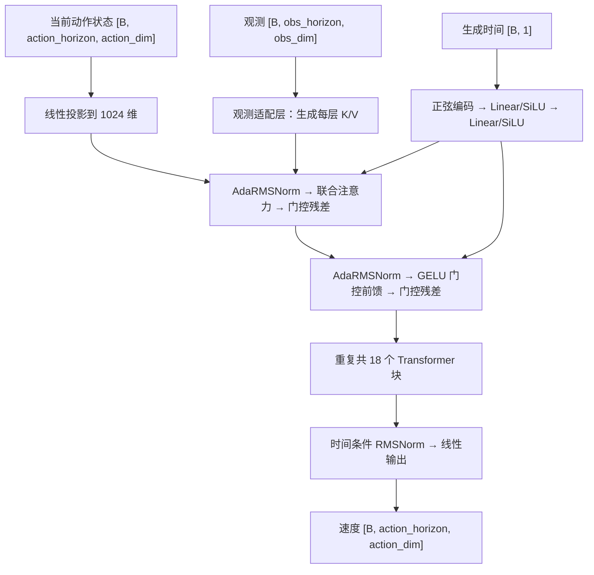

# Pi0.5 风格的动作速度场

`policy/fm_velocityfield.py` 中的 `Pi05VelocityField` 按 OpenPI 动作专家的核心结构实现速度场，并适配当前仓库已经编码好的观测。速度场 = 根据观测、当前动作状态与生成时间预测动作变化率的网络；Transformer = 基于注意力的序列网络。本实现从随机参数开始训练，不包含完整 Pi0.5 的 PaliGemma 视觉语言骨干或官方预训练权重，也没有与官方模型进行逐值数值等价验证。

本页张量中的 `obs_dim` 指编码器输出的特征维数，即 `encoder.output_dim`／运行快照中的 `resolved.policy.condition_dim`；通用 `PolicyConfig.obs_dim` 则是原始协议状态维数。例如 camera2 ResNet 可把图像编码成 256 维特征，协议仍保留 54 维状态，纯视觉模型不使用这些状态数值。



AdaRMSNorm = 由时间条件预测归一化后的缩放、平移及残差门控。每个动作位置可以关注全部动作位置和观测前缀，观测前缀不受噪声动作影响；没有自回归因果限制。注意力的查询和键使用 RoPE（旋转位置编码）。前馈网络使用 GELU 门控，归一化均方计算使用 float32，残差门控按 OpenPI 初始化为零。因此刚初始化时残差块是恒等映射，训练更新门控后，观测条件通过注意力影响输出。

| 参数 | 默认值 |
| --- | --- |
| `--pi05-width` | 1024 |
| `--pi05-depth` | 18 |
| `--pi05-heads` / `--pi05-kv-heads` | 8 / 1 |
| `--pi05-head-dim` | 256，独立于 `width / heads` |
| `--pi05-mlp-dim` | 4096 |

训练命令增加 `--fm-network pi05` 即选择该网络；`--hidden-dim` 和 `--depth` 仅控制残差 MLP。YAML 对应字段为 `policy.flowmatching.network: pi05`，其他字段将命令行连字符改为下划线，例如 `pi05_width`、`pi05_depth`。以上默认几何对应 OpenPI 的 `gemma_300m` 配置，但加上时间条件归一化、输入输出和观测适配层后，当编码特征维数为 256、动作维数为 3 时，本实现共有 **432,398,595** 个参数，不能把完整参数量直接称作 300M。

原版动作专家读取 PaliGemma 在每层产生的键和值（K/V）；本实现默认把 `[B, obs_horizon, obs_dim]` 投影为每层观测 K/V。这是最主要的结构边界。`encode_observations()` 可预先构造观测前缀，`forward_with_prefix()` 可直接接收外部逐层 K/V：每层为一对 `[B, kv_heads, prefix_length, head_dim]` 张量，键应已应用前缀位置的 RoPE；可选 `prefix_mask` 是 `[B, prefix_length]` 布尔有效位。该接口不负责转换或加载 OpenPI 权重。

本仓库使用均匀采样的生成时间 `t`，从 `t=0` 噪声积分到 `t=1` 动作，目标速度为 `actions-noise`，默认用 Heun 二阶积分器采样 40 步。OpenPI 参考代码采用 Beta 时间采样、相反的时间方向和默认 Euler 积分；这些训练与采样设置也不相同。三种本地速度场共用本仓库的 FM 目标与积分器，不能直接混用官方预训练权重及速度符号。

只验证流程时，可在 `Z:\ActionExpert` 的 `actionexpert` 环境中使用以下小配置。它把宽度减为 32、深度减为 2，训练 2 步：

```powershell
python -u -m learn.train --config configs\pusht_structured_state.yaml `
  --output-dir outputs\smoke_20261022\pusht_pi05 `
  --train-steps 2 --checkpoint-every 1 --batch-size 2 `
  --max-train-episodes 2 --val-ratio 0.01 --fm-network pi05 `
  --pi05-width 32 --pi05-depth 2 --pi05-heads 4 --pi05-kv-heads 1 `
  --pi05-head-dim 8 --pi05-mlp-dim 64 --sample-steps 2

python inference.py outputs\smoke_20261022\pusht_pi05\policy.pt `
  --env-name pusht --episodes 1 --max-steps 8 --device cuda --port 0
```

2026-10-22 已重新验证完整 18 层默认配置的 CPU 前向计算，输出 `[1,16,3]` 且全部有限；上述小配置已完成真实 PushT 数据训练和 TCP 仿真推理。现有测试还覆盖小配置的续训、采样、CUDA 混合精度、观测梯度、双向动作依赖、前缀屏蔽及权重保存恢复。日志和产物在 `outputs/smoke_20261022/`。完整默认配置的训练显存与任务成功率尚未验证，小配置通过不代表默认尺度可以沿用相同批大小。

参考：[OpenPI 动作与时间嵌入](https://github.com/Physical-Intelligence/openpi/blob/main/src/openpi/models/pi0.py)、[Gemma 动作专家配置及计算](https://github.com/Physical-Intelligence/openpi/blob/main/src/openpi/models/gemma.py)、[Pi0.5 配置](https://github.com/Physical-Intelligence/openpi/blob/main/src/openpi/models/pi0_config.py)。
